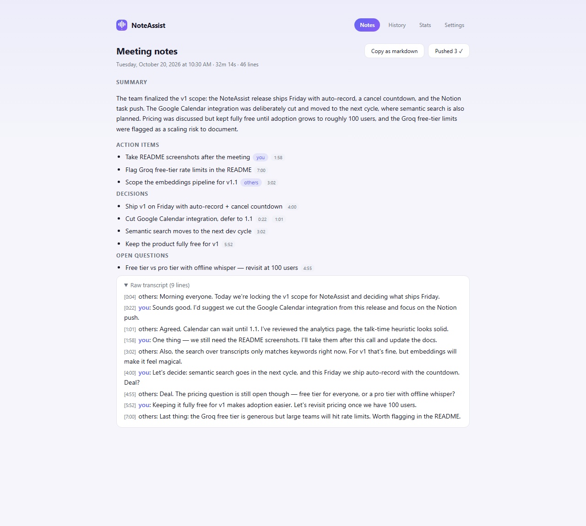
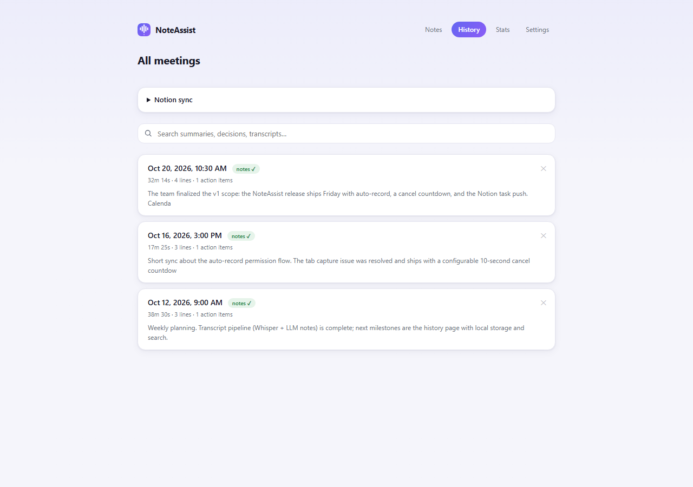
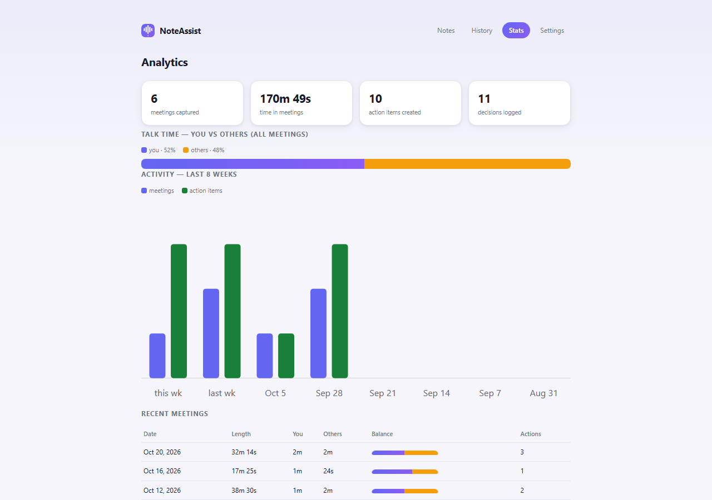

# NoteAssist

A Chrome extension that turns Google Meet calls into structured, evidence-linked meeting notes — automatically.

Join a call, and NoteAssist captures your voice (live Chrome speech engine) plus the meeting's tab audio (OpenAI Whisper via Groq's free tier), then generates notes with an LLM: **summary, decisions, action items with owners and timestamps, and open questions**. Every note item links back to the exact transcript line that supports it.

## Screenshots

| Notes | History | Analytics |
|---|---|---|
|  |  |  |

## Features

- **One-click capture** — status overlay inside Meet shows live transcription; optional auto-record with a cancelable countdown
- **Live transcript** — your mic transcribed in real time through Chrome's Web Speech API
- **Remote audio transcription** — tab audio via `whisper-large-v3-turbo`; ~1h meeting fits Groq's free 25MB limit (32kbps opus)
- **AI notes** — LLM extraction into structured JSON; every item must cite transcript line IDs, so nothing is untraceable
- **Searchable history** — search across all transcripts, summaries, decisions
- **Notion sync** — push action items to a Notion tasks database (one-time free setup)
- **Analytics** — talk-time balance (you vs others), weekly activity, action-item counts
- **Local-first** — all data stays in `chrome.storage.local`; nothing is stored on any server

## Setup from source

1. Clone/download this repo
2. Chrome → `chrome://extensions` → enable Developer mode → **Load unpacked** → select the folder
3. Create a free API key at [console.groq.com](https://console.groq.com) (no credit card)
4. Open the NoteAssist popup → paste the key → Save (or drop it into `secrets.txt` — see `.gitignore`)
5. Join any Google Meet call → press **Start** (or enable auto-record in Settings)

Optional: connect Notion from History → "Notion sync" to enable task pushing.

## Privacy

- Meeting data (transcripts, notes) never leaves your machine — stored in your browser profile
- Your speech is transcribed by Chrome's built-in speech engine (browser feature) and tab audio by Groq's Whisper API; the transcript (not raw audio) also goes to Groq's LLM for note generation
- `secrets.txt` and any pasted API keys are stored locally and git-ignored

## Architecture

Pure client-side, no build step, no frameworks:

```
popup (control) ─┐
content script ──┼─▶ background service worker (session orchestrator, storage, Notion)
                 │        └─▶ offscreen document (tab-audio capture, Whisper, LLM notes)
Meet tab ◀───────┘  live transcript overlay (Web Speech API)
```

- The offscreen document owns all long-running work (MediaRecorder, Groq uploads/LLM calls) because MV3 service workers can be killed mid-request
- Messaging contract: every listener returns `true` only when it will `sendResponse` (a hung channel from an unused `return true` is a classic MV3 bug)
- Icons generated from `docs/icon.svg` via `docs/make-icons.ps1` (GDI+)

## Roadmap

- [ ] Semantic search (embeddings over transcripts)
- [ ] Offline mode (whisper.cpp, fully local)
- [ ] Google Calendar push via OAuth
- [ ] Speaker diarization for meeting participants

## License

[MIT](LICENSE)
